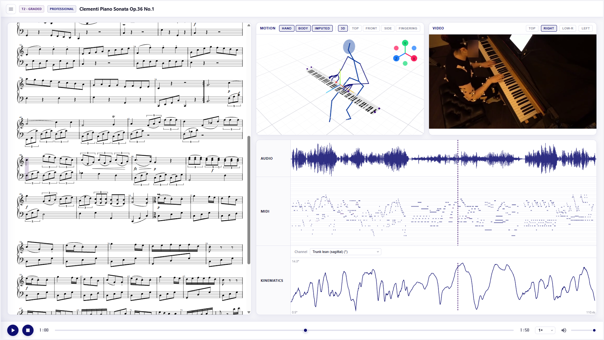

<div align="center">

# SKY-Piano

**A multimodal piano performance dataset**

Joonhyung Bae, Dawon Park, Taegyun Kwon, Yoon-Seok Choi, Hyeon Hur, Satoshi Obata,
Shigeru Kai, Yohei Wada, Yu Takahashi, Akira Maezawa, Jaebum Park, Jonghwa Park, Juhan Nam<br>
KAIST · Seoul National University · Yamaha Corporation

[](https://ismir2026program.ismir.net/poster_298.html)
[](https://huggingface.co/datasets/SKY-Piano/SKY-Piano)
[](LICENSE)
[](https://creativecommons.org/licenses/by-nc-nd/4.0/)

[Project page](https://joonhyungbae.github.io/skypiano/) ·
[Explorer](https://joonhyungbae.github.io/skypiano/explorer/) ·
[Paper](https://joonhyungbae.github.io/skypiano/paper.pdf) ·
[Video](https://youtu.be/SCbQMOKsNRk) ·
[Poster](https://joonhyungbae.github.io/skypiano/poster.png) ·
[Dataset](https://huggingface.co/datasets/SKY-Piano/SKY-Piano) ·
[ISMIR page](https://ismir2026program.ismir.net/poster_298.html)

</div>

SKY-Piano holds 11 hours of piano performance from 19 pianists (7 professional,
12 amateur): directly measured hand and body motion capture, synchronized with
audio, MIDI, multi-view video, MusicXML scores, Visual3D kinematics and
per-note pseudo fingering, on a shared core repertoire that crosses technique,
difficulty and expertise.

<p align="center">
  
</p>

<table>
<tr>
<td width="33%" valign="top"><b>Measured, not estimated</b><br>Hand (23 markers per side) and body motion from optical mocap at 120 Hz, frame-synchronized with audio, Disklavier MIDI and up to four camera views.</td>
<td width="33%" valign="top"><b>Controlled repertoire</b><br>Fink technique exercises, scale and arpeggio drills and graded pieces played by every performer of a group, plus free repertoire.</td>
<td width="33%" valign="top"><b>Fingering from mocap</b><br>Geometric scoring, z-onset refinement and a BiLSTM fill label every note, with the ambiguity of each label kept.</td>
</tr>
</table>

| | |
|---|---|
| Performance | 11 h synchronized |
| Pianists | 19 (7 professional, 12 amateur) |
| Pieces | 35 (technique, graded, free) |
| Motion | hand and body, 120 Hz, flagged and imputed |
| Video | up to 4 views (top, left, right, low right), face-anonymized |
| Annotations | MusicXML score alignment, per-note fingering, Visual3D kinematics |

This repository holds the code that built the dataset: the preprocessing
pipeline, the fingering pipeline, the fingering annotation tool, the explorer
and the project page. The pipeline is the as-built code that ran on our
recordings. Paths, marker conventions and per-session branches (the 2022 and
2024 sessions were recorded under different protocols) are specific to this
corpus, and the raw recordings it starts from are not public. We share it for
transparency and reproducibility, not as a general framework; the few helpers
that are reusable are listed under [Reusable helpers](#reusable-helpers).

## Contents

| Path                 | What it is |
|----------------------|------------|
| `pipeline/`          | Preprocessing pipeline, stages `01`–`12` in execution order |
| `pipeline/_common/`  | Helpers shared by several stages |
| `web/annotate/`      | Fingering annotation tool used for the paper's audit (React, Vite) |
| `web/explorer/`      | In-browser explorer for sample performances (React, Vite) |
| `web/projectPage/`   | Project page; publishes itself with the explorer nested at `/explorer/` |
| `setup.sh`, `requirements.txt` | Python environment |

## Setup

```bash
bash setup.sh                     # conda env "piano-corpus" (Python 3.10) + requirements.txt
pip install -r requirements.txt   # or into an environment of your own
```

SAITS imputation (Stages 06–07) and Tier C training (Stage 08) need PyTorch
with a GPU. Two external tools are installed separately:

- **Audiveris** (Stage 11, OMR): install from
  <https://audiveris.github.io/audiveris/> and put the `Audiveris` executable
  on `PATH`.
- **EgoBlur** (Stage 10, face anonymization): download `ego_blur_face.jit`
  from <https://www.projectaria.com/tools/egoblur/> into
  `pipeline/10_face_blur/models/`. The blur steps stop with an error if it is
  missing.

The web apps are static Vite sites with no backend: `npm install` then
`npm run dev` in `web/annotate`, `web/explorer` or `web/projectPage`. `npm run deploy` in
`web/projectPage` builds the page with the explorer and publishes it to the
`gh-pages` branch.

## Data layout

All scripts run from the repository root and read and write `Data/`, which is
not tracked:

```
Data/
  Raw/<session>/...               original recordings (not public)
  Metadata/<session>/...          session logs, labels and review verdicts
  Pipeline/NN_<stage>/...         each stage's output
  Release/vX.Y.Z/...              release manifests (Stage 12)
```

Sessions are named by recording date. The release covers `220819` and
`221112` (2022 protocol) and `240523` and `240828` (2024 protocol).

## Pipeline

Stages 01–05 align every modality; stages 06–11 are post-processing that reads
the aligned per-piece output and never changes the alignment; stage 12 decides
what a release version ships. Each stage keeps its entry scripts in `steps/`
(per modality where a stage has subfolders), its own modules in `src/`, and
single-use tools in `tools/`. Stages 01–05 and 11 run with
`python pipeline/NN_<stage>/run_pipeline.py --dataset <session>`, stages 06–10
with `pipeline/NN_<stage>/run_stage.sh`; Stage 12 is run by hand.

| Stage | Name | What it does | Sessions |
|------:|------|--------------|----------|
| 01 | `ingest` | Pair each trial's raw audio, MIDI, motion and video; canonical per-trial layout | all |
| 02 | `spatial` | Hand markers into one metric keyboard frame; body registered onto the hand frame | all |
| 03 | `sync` | MIDI and video aligned to motion (signal cross-correlation for 2022, SMPTE timecode for 2024) | all |
| 04 | `piece_split` | Piece windows and names; every modality cut per piece | all |
| 05 | `alignment_qa` | Record of the by-eye sync and piece confirmations; the gate before post-processing | all |
| 06 | `hand_imputation` | SAITS gap filling of hand markers, one model per performer | `240828` |
| 07 | `body_imputation` | SAITS gap filling of body markers | `240828` |
| 08 | `fingering` | Per-note fingering in three tiers (see [Fingering](#fingering)) | released |
| 09 | `visual3d` | Body segments and kinematics in the Visual3D convention | `240828` |
| 10 | `face_blur` | EgoBlur face anonymization of released video | released (top view) |
| 11 | `score_alignment` | Audiveris OMR and note-level score-to-MIDI alignment | `240828` |
| 12 | `release` | Release manifest; Hugging Face and Zenodo upload | released |

### Alignment (01–05)

**Two protocols.** In 2024 every stream carries a shared SMPTE timecode, so
trials are cut and MIDI is aligned by timecode. In 2022 there is no shared
timecode: trials are paired and motion is aligned to MIDI by signal
cross-correlation, and the final offset is refined per trial from the
fingertips' key-press activity against the MIDI onsets. `01_ingest/steps/`
has one step per session strategy.

**221112** keeps one continuous recording per subject and one motion file per
take, and its subject folders, recordings and session logs are not numbered
consistently. `01_ingest/steps/s04_221112_slice.py` pairs them by content (a
log's piece starts fall on the note onsets of exactly one recording; a motion
folder's takes correlate at note level with one recording near the log's trial
start signals), places every take in its recording and cuts audio and MIDI
there, so trial time equals motion time. Pieces come from the log
(`04_piece_split/steps/s08_221112_log_pieces.py`).

**220819** pieces are cut from the session log's windows by
`04_piece_split/anchors_220819/`: a logged window is shifted to the
audio-located start when the two agree within 1 s, overlapping windows of
back-to-back pieces are split at the longest silence between note onsets, and
a logged piece with no notes in the recording is dropped. Each camera is put
on the trial audio clock through its own audio track, constrained by
wall-clock starts (Qualisys time stamps, GoPro creation times) because a
session holds several takes of the same pieces.

**Piece windows.** A piece's core runs from its first onset to when its last
note stops sounding (sustain pedal included), padded by a short lead-in
(0.3 s in the session-log cuts) and 1.0 s after, but never into another note;
a window set by the reviewer is used as the core. `04_piece_split/steps/s07_apply_discard_intervals.py` applies the
session notes' discard intervals that fall inside a window: the piece keeps
the part before, and the part after becomes a new piece unless another piece
already covers it.

**Review gate (05).** Whether an alignment is right is judged by eye on review
pages that are not part of this release;
`03_sync/midi_motion/steps/s04_review_inputs.py` prepares what they show.
`05_alignment_qa/run_pipeline.py` records the verdicts per session in
`Data/Pipeline/05_alignment_qa/<session>/_status.json`: per trial the sync
source, its signal level and the verdict; per piece its window, exact window
findings (overlap with a neighbour or a discard interval, a window ending
while the last note sounds), its name and the name's source, and the verdict.
A session passes when every trial with hand motion and every piece is
confirmed; only sessions that passed are released.

### Fingering

`pipeline/08_fingering` labels every MIDI note with a hand and finger from the
measured fingertips, following the three tiers of the paper:

- **Tier A** (`src/fingering_mocap.py`): geometric scoring adapted from
  PianoVAM. Each key is a 3D rectangle in a keyboard frame anchored on the
  keyboard-end markers; each fingertip accumulates a duration-averaged score
  over frames below the press depth, and a note is labeled when exactly one
  finger is a strong candidate. Multi- and no-candidate notes are kept with an
  explicit flag.
- **Tier B** (same module): z-onset refinement. Within ±25 ms of the onset, a
  multi-candidate note goes to the lowest fingertip if it leads the runner-up
  by at least 5 mm; a no-candidate note is rescued with a relaxed key region
  but a strict press depth.
- **Tier C** (`src/finger_imputer.py`): a BiLSTM fills the remaining notes
  from context, with the softmax restricted to the geometric candidates of a
  multi-candidate note.

| Step | Script | |
|------|--------|---|
| s01 | `steps/s01_pseudo_fingering.py` | Tiers A and B per piece → `Data/Pipeline/08_fingering/Fingering/` |
| s02 | `steps/s02_export_annotations.py` | Human verdicts from the annotation tool → release annotation file |
| s03 | `steps/s03_train_tier_c.py` | Train Tier C on SKY-Piano Tier A labels plus PIG (Nakamura et al. 2020, obtained separately) |
| s04 | `steps/s04_release_fingering.py` | `fingering.csv` per released performance, Tiers A → B → C |

`run_stage.sh --version X.Y.Z --hand raw|imputed` runs s01, s02 and s04;
training runs only when asked (`STEPS="s03" ./run_stage.sh`). The released
Tier C weights were trained with `--data mix` (84.3% recovery of held-out
Tier A labels); `s03` refuses to overwrite existing weights without
`--overwrite`. The annotation tool in `web/annotate` shows a piece's piano
roll, top-view video and 3D hand markers and records a finger per note; the
paper's 2,269-note audit was labeled with it.

### Release (12)

`pipeline/12_release/build_manifest.py --version X.Y.Z` writes
`Data/Release/vX.Y.Z/manifest.csv` (released path → source file in `Data/`;
nothing is copied), `performances.csv`, `participants.csv`, `repertoire.csv`,
`takes.csv`, `pieces.csv` and `summary.json`. The piece-level layout is

```
data/P<id>/<task>/<piece>/r<n>/      one performance (free repertoire: free/take<nn>/)
  audio.wav  midi.mid  hand.csv  body.csv  fingering.csv  [top.mp4]
  [hand_imputed.csv  hand_imputed_mask.csv  fingering_imputed.csv]
```

with the participant id (1–19), the task read from the piece (`technique1`
Fink exercises, `technique2` drills, `technique_extra`, `graded`, `free`) and
the participant's n-th performance of the piece. The release holds one
confirmed performance per participant, task, piece and round: `240828` one
per programme pass, `221112` one confirmed take per subject and piece,
`220819` every planned repeated take, and `240523` (amateur free repertoire)
whole takes. `top.mp4` is the EgoBlur-anonymized top view
(`--optional-in top=<sessions>`); the imputed files (`--imputed-model TAG`)
are the gap-filled hand motion, its mask (1 = filled) and the fingering
computed from it.

The full recordings are released as well: `build_trials.py` writes every take
of every released session, whole, to `Data/Pipeline/12_release/trials/` on the
clock the piece cuts use (time 0 = the take's audio start; motion at 120 fps),
with the audio muted wherever the piano is silent by the MIDI (each note kept
from 0.1 s before its onset to 0.5 s after it stops sounding, sustain pedal
included; 20 ms fades). It checks that cutting these files at each piece
window reproduces the piece files. The manifest lists them as

```
data/P<id>/takes/<session>_<take>/   one whole take, e.g. takes/240828_T1_P13_t1/
  audio.wav  midi.mid  hand.csv  body.csv
```

(221112 participants 14 and 18 have motion only; take-level video is not
released yet), with `takes.csv` (one row per take) and `pieces.csv`: every
piece window cut in a take (start and end on the take clock, motion rows),
its piece id, task and status (`confirmed`, `retake`, `rejected`,
`practice_variant`, `not_a_piece`, ...), and `best` with the path of the
representative performance in the piece-level folders.

`upload_hf.py --version X.Y.Z --repo SKY-Piano/SKY-Piano` sends a version
straight from `Data/` (only changed files) and tags it `vX.Y.Z`;
`upload_zenodo.py` archives 1.0.0 on Zenodo. Versions follow semantic
versioning: pre-1.0 versions add sessions and modalities as they pass Stage 05
and are finished, and 1.0.0 is the complete release described in the paper.
The dataset card on Hugging Face lists what each version contains.

## Reusable helpers

Most code is tied to this corpus. These helpers make no corpus-specific
assumptions and can be imported on their own (all in `pipeline/_common/`
unless noted):

- `midi_xcorr.py`: coarse-to-fine cross-correlation alignment of audio
  against MIDI
- `video_xcorr.py`: video alignment through the camera's audio track
- `transform.py` (in `pipeline/02_spatial/hand/src/`): 3D rotation, axis
  alignment and coordinate utilities
- `slicing.py`: `slice_audio` / `slice_midi` for cutting audio and MIDI by
  timestamps

The other modules in `_common/` are corpus-specific code shared across stages
(normalized-data paths, the known-absences registry of permanent capture
gaps, motion–MIDI correlation, score following, piece naming).

## Not included

- **Tipiano fine-tuning baseline.** The paper fine-tunes Tipiano on the
  professional cohort (5-fold leave-one-pianist-out) as a use case. Tipiano
  is still under review and has not been released, so the scripts that
  convert the dataset to its input format, run the folds and evaluate them
  will be added once it is published.
- **Internal review tools.** The review pages used to confirm syncs and piece
  cuts, and one-off audit scripts, are not released; their verdicts are
  recorded by Stage 05 and decide what the release contains.

## Acknowledgments

This work was supported by the Seoul National University Research Grant in
2021 and the Yamaha Corporation Research Grant. The pipeline builds on
[PianoVAM](https://arxiv.org/abs/2509.08800) (fingering scoring),
[SAITS](https://github.com/WenjieDu/SAITS) (imputation),
[EgoBlur](https://github.com/facebookresearch/EgoBlur) (face anonymization),
[Audiveris](https://audiveris.github.io/audiveris/) (OMR),
[Parangonar](https://github.com/sildater/parangonar) (note alignment) and the
[PIG dataset](https://doi.org/10.1016/j.ins.2019.12.068)
(Tier C prior).

## License

The code is released under the MIT License ([`LICENSE`](LICENSE)). The
dataset is licensed separately under CC BY-NC-ND 4.0 with an Additional
Permission for Research Use; its terms come with the dataset.

## Citation

```bibtex
@inproceedings{bae2026skypiano,
  title     = {{SKY-Piano}: A Multimodal Piano Performance Dataset},
  author    = {Bae, Joonhyung and Park, Dawon and Kwon, Taegyun and
               Choi, Yoon-Seok and Hur, Hyeon and Obata, Satoshi and
               Kai, Shigeru and Wada, Yohei and Takahashi, Yu and
               Maezawa, Akira and Park, Jaebum and Park, Jonghwa and
               Nam, Juhan},
  booktitle = {Proceedings of the 27th International Society for Music
               Information Retrieval Conference (ISMIR)},
  address   = {Abu Dhabi, UAE},
  year      = {2026}
}
```
